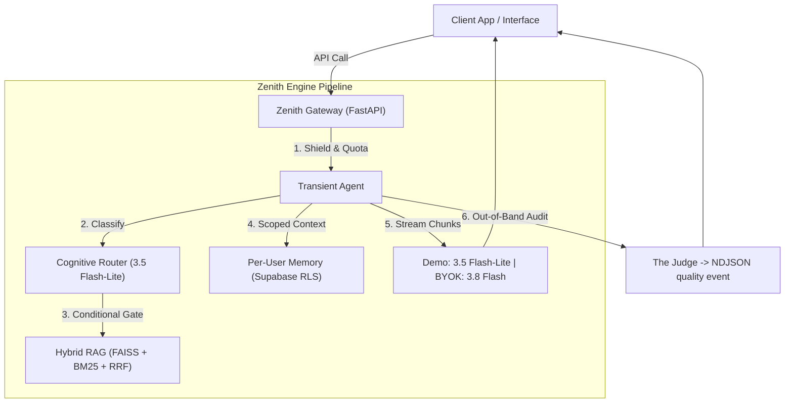

# Zenith | Prompt Architect Engine

**Zenith** é um **Motor Cognitivo Headless** e uma **Bancada Didática de Engenharia de Prompts**. Ele transforma pedidos vagos em prompts estruturados de alto nível, ensina *por que* cada técnica foi escolhida e opera com **Modo Híbrido** (Demo Grátis sem atrito + BYOK opcional para destravar `gemini-3.8-flash`).

---

## 🧠 Como o Zenith Funciona

1. **Input Shield (`SemanticValidator`)**: Bloqueia vazamento de credenciais (`sk-`, `AIza`, `ghp_`, `AKIA`), cartões de crédito (via checksum Luhn sem falsos positivos em CNPJs/IDs), tentativas de jailbreak e payloads acima do limite.
2. **Roteador Cognitivo (`StrategicAnalyzer`)**: Classifica natureza, complexidade e estratégia antes de consultar o RAG — economizando cota em pedidos simples.
3. **RAG Híbrido Condicional**: Combina busca vetorial (**FAISS** + `models/gemini-embedding-2`), busca lexical (**BM25**), **Reciprocal Rank Fusion (RRF)** e reranking com LLM apenas quando a complexidade exige fundamentação na base técnica.
4. **Memória Semântica Multi-Tenant (`StrategicMemory`)**: Isolada estritamente por `user_id` e persistida no Supabase (`user_memories`) com políticas de Row-Level Security (RLS).
5. **Auditoria Inteligente (`TheJudge`)**: Avalia respostas complexas fora de banda e emite eventos tipados `quality` via NDJSON (sem duplicar texto nem poluir o histórico).

---

## 🏗️ Arquitetura e Modos de Execução

* **Modo Demo (Sem API Key do usuário):** usa a chave do servidor com **`gemini-3.5-flash-lite`** (`thinking_level="low"`) e limite diário configurável (`DEMO_DAILY_LIMIT=5`) por conta.
* **Modo Pro / BYOK (Com `x-google-api-key` opcional):** redireciona **todos** os módulos (Chat, Analyzer, Judge, Reranker e Memory) para a chave do usuário e libera **`gemini-3.8-flash`** (`thinking_level="medium"`) sem consumir cota do servidor.

### Stack Tecnológico

* **Core**: Python 3.10+ com Pydantic Settings e Type Hinting.
* **API**: FastAPI (Assíncrono) com streaming NDJSON tipado (`meta`, `chunk`, `quality`, `error`) e CORS configurável (`ALLOWED_ORIGINS`).
* **Inteligência**: Arquitetura Híbrida 100% Free Tier — `gemini-3.8-flash` (BYOK) + `gemini-3.5-flash-lite` (Demo & Módulos Auxiliares) + `models/gemini-embedding-2` (Embeddings RAG).
* **Persistência & Segurança**: Supabase (Auth + PostgreSQL com RLS via [001_user_memories_and_rls.sql](supabase/migrations/001_user_memories_and_rls.sql)) + FAISS local / BM25 em memória.

---

## 📚 Endpoints da API

* **`GET /health`**: Health check do serviço (também usado para aquecer instâncias serverless).
* **`POST /token`** & **`POST /register`**: Autenticação via Supabase Auth (JWT).
* **`GET /quota`**: Retorna o modo ativo (`demo` ou `byok`), modelo em uso e cota diária restante.
* **`POST /chat`**: Endpoint principal de streaming NDJSON tipado.
* **`GET /sessions`**: Lista as sessões recentes do usuário autenticado.
* **`GET /sessions/{session_id}/messages`**: Recupera o histórico da sessão após validação de ownership.
* **`DELETE /sessions/{session_id}`**: Remove sessão e interações pertencentes ao usuário.
* **`POST /feedback`**: Encaminha feedback via Supabase Edge Function.

---

## ⚙️ Migração do Banco (Supabase)

Execute o script SQL [supabase/migrations/001_user_memories_and_rls.sql](supabase/migrations/001_user_memories_and_rls.sql) no SQL Editor do seu projeto Supabase para criar a tabela `public.user_memories` e habilitar Row-Level Security (RLS) em todas as tabelas por usuário.

---

## 📜 Licença e Propriedade

Este software é um ativo intelectual proprietário.
**Desenvolvido por Thiago Dias Precivalli.**
Todos os direitos reservados.
